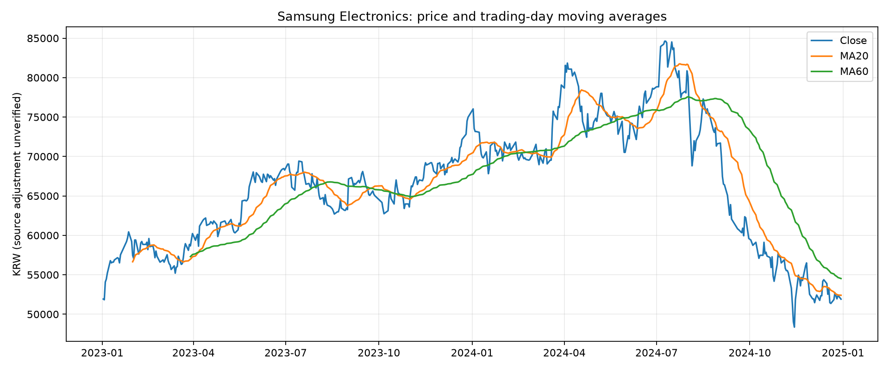
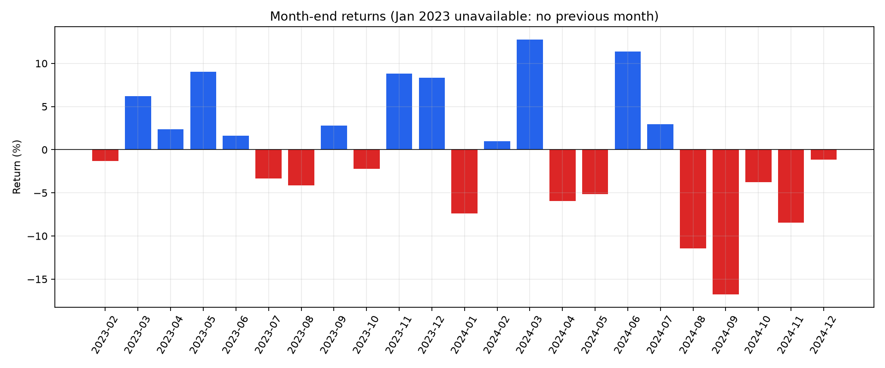
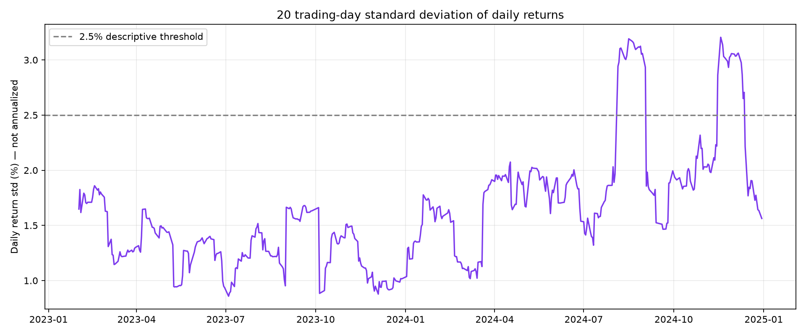
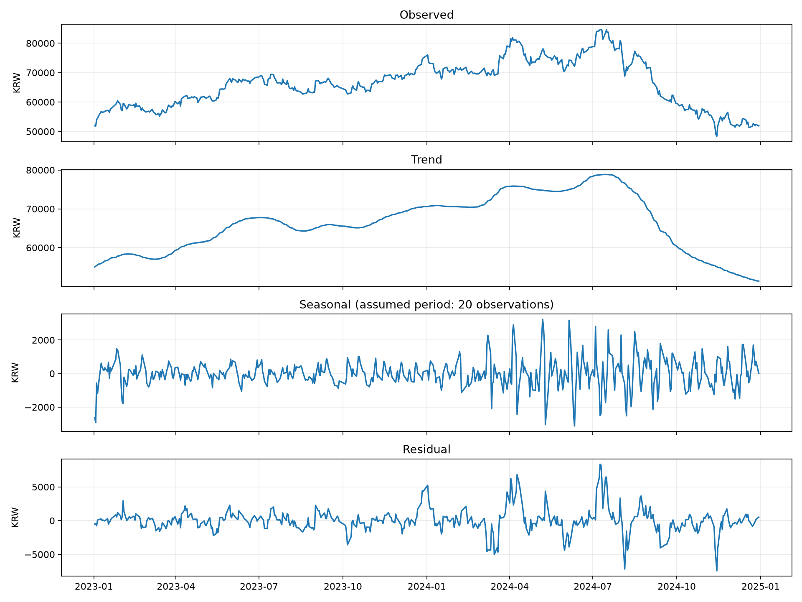

# 삼성전자 2023~2024년 주가 시계열 분석

## 1. 주제와 질문
삼성전자의 저장 가격에서 추세·월별 변화·위험 구간을 탐색한다.
1. 전체와 연도별 가격 방향은 같은가? 이동평균은 어떤 추세를 보이는가?
2. 두 해에서 월별 수익률이 반복되는가? 특정 계절의 효과를 주장할 수 있는가?
3. 변동성 최고 시점과 최대 낙폭은 언제인가?

## 2. 데이터와 정제
- 출처: [Yahoo Finance 삼성전자](https://finance.yahoo.com/quote/005930.KS/history/), `005930.KS`. 기존 노트북의 yfinance 수집 코드에서 출처를 확인했다.
- 실제 기간: 2023-01-02 ~ 2024-12-30, **489개 거래일**. `Date`는 날짜, `Close`는 저장 가격(원)이다.
- 기존 CSV는 그대로 보존한다. 수집 시각·auto_adjust 설정·당시 버전이 없어 수정주가 여부는 확정할 수 없다. 거래소 원종가나 배당 포함 총수익률로 단정하지 않는다.
- 날짜·숫자 변환, 날짜 정렬, 중복, 결측, 무한대와 0 이하 가격을 검사한다. 현재 결측 0개, 중복 날짜 0개이며 오류는 임의 보간 대신 실행 중단으로 처리한다.
- 휴장일은 관측치가 아니므로 주말·공휴일을 추가하거나 ffill하지 않는다. 거래소 달력과 대조하지 않아 거래일 누락 여부까지 검증한 것은 아니다.
- 이상치 검토 기준은 일간 절대 수익률 5% 초과로 5건이다. 실제 급변 가능성이 있어 제거하지 않고 `data/flagged_returns.csv`에 기록한다. 이 기준은 검토용이며 통계적 이상 판정이 아니다.

## 3. 분석 기법과 시각화
20·60거래일 이동평균으로 단기 잡음을 완화한다. 일간 수익률은 `(현재/직전-1)×100`, 월별은 월말 마지막 관측 가격 변화율이다. 월 단위는 두 해의 같은 달 비교를 위해 선택했다. 2023년 1월은 전월 자료가 없어 결측으로 유지하며 0%로 그리지 않는다.
변동성은 최근 20거래일 일간 수익률의 표본 표준편차(ddof=1)로 연율화하지 않는다. 이동 구간 초기 결측은 정상 준비 구간이다. 낙폭은 직전 누적 최고 가격 대비 변화율이다.

첫 가격 51,925.34원에서 마지막 51,911.94원으로 전체 변화는 -0.03%이다. 최고는 2024-07-09 84,619.20원, 최저는 2024-11-14 48,362.08원이다.

| 연도 | 관측 수 | 첫 가격 | 마지막 가격 | 연내 첫 관측 대비 |
|---|---:|---:|---:|---:|
| 2023 | 245 | 51,925.34 | 74,979.45 | +44.40% |
| 2024 | 244 | 76,030.11 | 51,911.94 | -31.72% |

위 변화율은 전년 말 대비 연간 수익률이 아니다.

최고 월은 2024-03 +12.77%, 최저 월은 2024-09 -16.76%이다. 부록의 월별 값으로 두 해의 차이를 확인한다.

변동성 최고는 2024-11-18 3.21%, 2.5% 초과는 40일이다. 최대 낙폭은 2024-11-14 -42.85%이다. 임계값은 사후 설명용이다.

실제 `STL(period=20, robust=True)`을 적용했다. 추세는 완만한 흐름, 계절 성분은 가정한 20관측 반복, 잔차는 나머지이다. 거래일 20개는 달력 월과 다르고 계절 성분 출력 자체가 경제적 계절성의 증거는 아니다. 전체 표본을 사용한 사후 분해이므로 실시간 예측 지표로 해석할 수 없다.

## 4. 인사이트
### 1) 전체 변화율은 중간 손실 위험을 숨긴다
- **관찰:** 전체 변화 -0.03%와 달리 누적 최고 대비 최대 낙폭은 -42.85%이다. 연도별 변화 및 이동평균을 함께 봐야 한다.
- **가설:** 기업 전망·시장 위험 선호 변화가 추세 차이에 영향을 주었을 수 있다. 가격만으로 원인을 확인하지 않았다.
- **다음 행동:** 업종·시장 지수와 같은 기간을 비교해 기업 고유 변화와 공통 움직임을 구분한다.

### 2) 특정 월의 유불리를 일반화하기 어렵다
- **관찰:** 월별 최고 +12.77%와 최저 -16.76%의 차이가 크다. 같은 달 표본은 최대 2개이며 1월 유효 수익률은 1개다.
- **가설:** 반복 계절성보다 해당 연도의 추세나 사건이 영향을 주었을 수 있다. 두 해로 설명을 선택할 수 없다.
- **다음 행동:** 더 긴 기간과 표본 밖 검증으로 같은 달의 방향이 반복되는지 확인한다. 특정 월 매매 규칙은 도출하지 않는다.

### 3) 변동성은 위험 크기를 보여주지만 방향을 보장하지 않는다
- **관찰:** 변동성 최고는 2024-11-18 3.21%이고 최대 낙폭일은 2024-11-14이다. 기존의 '전환점과 정확히 일치' 주장은 검증 근거가 없어 제거했다.
- **가설:** 정보 충격이나 거래 집중이 가격 급변을 만들었을 수 있다. 거래량·뉴스 없이 검증할 수 없다.
- **다음 행동:** 급변일 원자료를 점검하고 변동성 상승 후 방향의 빈도와 예측력은 별도 표본으로 평가한다.

## 5. 결론과 한계
전체 변화와 중간 위험은 다르므로 월별 변화와 변동성을 함께 관찰해야 한다. 단일 종목 2년 표본, 조정 여부 미확정, 거래소 달력 미대조, 외부 변수 미포함, 임의 STL 주기 때문에 인과·계절성·매매 성과를 주장할 수 없다.

## 6. 재현 및 이용 조건
저장소 루트에서 `python -m pip install -r requirements.txt`, `python analysis.py` 순으로 실행한다. 네트워크 없이 원본 CSV에서 본 리포트·그림 4개·파생 CSV 3개를 생성한다. 노트북은 위에서 아래로 실행한다.
기존 학습용 표본의 별도 데이터 라이선스는 확인되지 않았다. 재이용·재배포 전 [Yahoo 이용약관](https://legal.yahoo.com/us/en/yahoo/terms/otos/index.html) 및 원천 제공자의 조건을 확인해야 한다. 공개 저장소 자체가 데이터 재배포 권한을 뜻하지 않는다.

## 7. AI 사용 로그
- **작업:** 미션과 기존 코드 비교, 정제 검사, 실제 STL 구현, 수치 기반 보고서·그래프·실행 문서 작성.
- **이유:** 보고서와 코드 불일치 해소 및 저장 데이터에서 재현 가능한 분석 구성.
- **검증:** 입력 행 수·범위·결측·중복·유효 가격 검사, 전체 재실행, 파생 CSV와 월별 변화·극값 대조. 자동 검증 기록이며 작성자 본인의 독립적인 해석 검토를 대신하지 않는다.
- 실행 환경: Python 3.14.7, pandas 3.0.6, matplotlib 3.11.2, statsmodels 0.15.0.
- 원본 SHA-256: `0a5f4e905362a54f9d9fb0154cf3b6d9cbfb01862017257fda09ecdf11058dc7`

## 부록: 월말 수익률 검증표
| 월 | 직전 월말 대비 |
|---|---:|
| 2023-02 | -1.30% |
| 2023-03 | +6.22% |
| 2023-04 | +2.34% |
| 2023-05 | +9.01% |
| 2023-06 | +1.63% |
| 2023-07 | -3.32% |
| 2023-08 | -4.15% |
| 2023-09 | +2.78% |
| 2023-10 | -2.19% |
| 2023-11 | +8.82% |
| 2023-12 | +8.34% |
| 2024-01 | -7.39% |
| 2024-02 | +0.96% |
| 2024-03 | +12.77% |
| 2024-04 | -5.95% |
| 2024-05 | -5.16% |
| 2024-06 | +11.38% |
| 2024-07 | +2.94% |
| 2024-08 | -11.44% |
| 2024-09 | -16.76% |
| 2024-10 | -3.74% |
| 2024-11 | -8.45% |
| 2024-12 | -1.18% |
